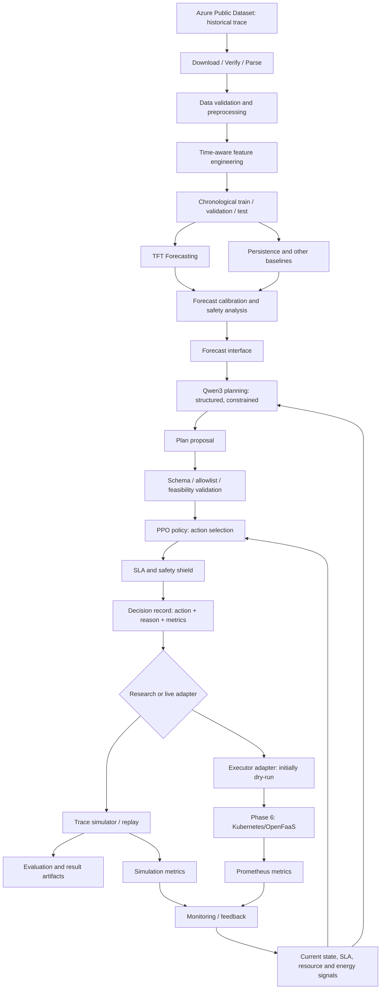

# Implementation Plan — Predictive Container Management for Energy-Efficient Serverless Computing

**Primary repository:** https://github.com/charanp2006/MP  
**Primary branch:** `main` (use feature branches and PRs)  
**Project direction:** Build and validate AI Decision Engine (3–5) first; integrate real execution (6) and monitoring/feedback (8) next. Defer Users/Clients (1), generic Workload Ingestion (2), and Applications/Services (7) as dedicated phases, but define their contracts now so the core remains integration-ready.

> **V2 addendum (2026-11-24):** Components 1, 2 and 7 are no longer deferred;
> prototype implementations are complete on `dev` (`ea73cbc`, `9b340a4`,
> `ac9329a`). The local llama-style route originally planned here — Ollama
> serving Qwen3, with llama.cpp/GGUF as a possible alternative — is now
> **outdated**. It was chosen for offline reproducibility but depended on a
> local model process, suitable laptop hardware, manually pinned tags and
> quantization, and it never produced real Qwen3 inference evidence. The
> owner's V2 direction replaces it with hosted Hugging Face inference as
> primary and OpenRouter as a key-based backup. See `docs/implementationv2/m0-audit.md`,
> `docs/azure-dataset-availability.md` and
> `docs/qwen3-hosted-inference-plan.md`. The detailed V2 plan is
> `IMPLEMENTATIONV2.md`; this v1 plan is retained as historical context and
> updated where directions changed.

---

## 0. Working principles and scope

1. `MP` is the single source of truth. Do not develop the final system in the fork.
2. Use the official Azure Functions workload source: https://github.com/Azure/AzurePublicDataset . Do not simply copy the friend's processed CSV.
3. Synthetic data is useful for controlled stress tests, edge cases, smoke tests, and demonstrations; it must not be presented as real-world evidence.
4. Azure historical data is real workload data, but it is not live telemetry from our own deployed serverless platform. Label these data sources distinctly.
5. Make research mode and live mode share model, decision, safety, metric, and result schemas.
6. Do not claim measured energy, cold-start reduction, SLA compliance, production readiness, or live operation unless the measurement method and evidence support the claim.
7. Implement in small, reviewable commits. Agents must inspect existing code before modifying it and avoid replacing modules wholesale without justification.
8. Never use untrusted workload inputs to execute arbitrary commands, LLM-generated code, or unrestricted cluster operations.
9. Every experiment must be reproducible: seed, dataset version/hash, time split, config, model/checkpoint, environment, commit SHA and results recorded.
10. Build functionality in vertical slices and keep CI green.

## 1. Target architecture for this phase



The diagram represents the intended integration. The implementation must not imply all boxes are already working.

### Shared interfaces

Define or confirm stable, typed interfaces for:

- `WorkloadForecast`: timestamps, horizon, point forecasts, optional uncertainty/quantiles, model ID, feature/version metadata.
- `SystemState`: current/desired container counts, observed workload, latency percentiles, resource utilization, cold-start state, SLA status, metric timestamps and freshness.
- `PlannerRequest` / `PlannerResponse`: bounded context, structured proposal, rationale, constraints, model metadata and failure/fallback status.
- `Action`: a small allowlisted enum and validated parameters. Never accept arbitrary command strings from the LLM or policy.
- `DecisionRecord`: input snapshot, forecast, planner proposal, PPO observation/action, safety overrides, final action, reason codes, timestamps and correlation ID.
- `EvaluationRun`: run ID, scenario, seed, trace identity, config hash, model versions, commit SHA, metrics and artifact locations.

Check existing contracts in `MP` and extend them; do not duplicate them unnecessarily.

---

## 2. Phase A — Repository audit, baseline and integration contracts

### Tasks

1. Start from clean `MP/main`; record current commit SHA.
2. Create a feature branch for this phase.
3. Run existing tests and CI-equivalent checks locally.
4. Inventory modules, TODOs, stubs, current data flow and configuration.
5. Document current modules that can be reused and identify conflicting schemas.
6. Define shared workload units, time interval, container-count semantics, SLA semantics and metric units.
7. Establish a common config format with validation.
8. Establish artifact directory conventions, experiment IDs and metadata.
9. Add a reproducible run command and smoke-test command.
10. Keep the default runtime safe (stub/dry-run) until explicitly configured.

### Acceptance criteria

- Baseline tests pass or existing failures are documented with reproduction steps.
- A small sample/synthetic trace passes through the current pipeline.
- Contracts and units are documented.
- No hidden, untracked data dependency is required to run the smoke test.
- CI remains green.

---

## 3. Phase B — Official Azure dataset acquisition and preparation

### Source

Use the official Azure dataset repository: https://github.com/Azure/AzurePublicDataset

Before coding a downloader, inspect the repository's current README, license/usage conditions, data layout, data dictionaries, file sizes, date ranges, schema and available trace variants. Do not assume filenames, columns or a particular dataset version. Record the source URL, retrieval date, commit/tag (if available), license and SHA-256 hashes.

### Data pipeline requirements

Implement an explicit pipeline with separable steps:

1. `inspect`: list data files, sizes, schemas and metadata without downloading everything.
2. `download`: resumable and configurable; support selected files/date ranges where source permits.
3. `verify`: hashes when provided, file integrity, source metadata and license.
4. `parse`: robust parsing with schema validation.
5. `aggregate`: derive workload series at configurable intervals (default experiment interval can be 5 minutes, but justify it and make it configurable).
6. `clean`: duplicate handling, missing values, invalid values, time zones, timestamp ordering and gap detection.
7. `features`: calendar features, lag features, rolling statistics and optional service/function grouping; avoid future leakage.
8. `split`: chronological train/validation/test splits, never random split for time series.
9. `export`: save clean dataset and metadata manifest.
10. `visualize`: dataset coverage, missingness, workload distribution, daily patterns, peaks and split boundaries.

### Dataset cautions

- The Azure Public Dataset may contain different trace types and schema variants. Inspect and select the trace that best matches the project's serverless workload semantics; explain the selection.
- A trace of function invocation/completion counts is not automatically request arrival rate or concurrent execution.
- If concurrency is inferred from invocation count and duration, label it as an estimate and document assumptions.
- Do not derive real CPU, memory, power or P95 latency from a trace that does not contain them. Simulate or estimate these only in clearly labelled simulation fields.
- Do not fabricate SLA or power measurements.
- Keep raw data out of Git if its size/license warrants; use reproducible download scripts, manifest, documentation and small sample fixtures.
- If the official source has a restrictive or unclear license/terms, stop and resolve before distributing derived data.

### Acceptance criteria

- One command obtains or prepares the selected official trace.
- One command validates and aggregates it.
- A manifest includes source, date, hash, schema, units, aggregation, missingness and split boundaries.
- The dataset is visualized and reviewed.
- A test detects data leakage, duplicate timestamps, invalid units and missing intervals.
- A tiny fixture lets CI test preprocessing without downloading the full dataset.

---

## 4. Phase C — Forecasting engine (Architecture component 3)

### Goal

Train, evaluate, visualize and package a Temporal Fusion Transformer (TFT) on the selected official Azure workload trace, with fair baseline comparisons. The model must produce forecasts that the controller can consume in a common format.

### Baselines

At minimum:

- Persistence: next value equals latest observed value.
- Seasonal persistence, if appropriate to the selected interval and data.
- A simple moving-average or other transparent baseline, if useful.
- TFT.
- Optional log-transformed TFT only if motivated and evaluated fairly.

### Training and evaluation

1. Define the target precisely (e.g., aggregated invocation rate or a justified estimated concurrency target).
2. Define horizons and align target timestamps (e.g., 5, 10 and 15 minutes if the chosen interval supports them).
3. Use chronological splits and fit normalization/transformation only on training data.
4. Use validation for tuning/early stopping; reserve test data for final evaluation.
5. Use rolling-origin or multiple chronological folds where feasible.
6. Train with documented seed, configuration and compute settings.
7. Save checkpoint, config, feature list, scaler, target transform and metadata.
8. Run inference on the held-out test period.
9. Evaluate overall and peak/high-load subsets separately.
10. Report MAE, RMSE, sMAPE or WAPE (define handling of zeros), bias, peak underprediction rate, and optional interval/quantile calibration.
11. Compare each model on identical timestamp/horizon subsets.
12. Avoid cherry-picking; report all predeclared metrics.
13. If TFT does not beat persistence, report honestly. Investigate data/feature/target quality, then decide whether TFT remains useful for downstream control.

### Visualization deliverables

Generate plots (PNG and optionally HTML):

- Actual vs predicted over full test range.
- Zoomed burst/peak periods.
- Prediction error over time.
- Residual distribution.
- MAE/RMSE/WAPE comparison bars or tables.
- Peak-underprediction analysis.
- Forecast horizons side-by-side.
- Training/validation loss curve.
- Optional prediction intervals/quantile coverage.
- Train/validation/test boundary and dataset coverage.

### Forecast interface and online path

- Add a forecast service with batch training/evaluation and single-step/rolling inference interfaces.
- Validate model artifact and input feature order.
- Handle missing/stale inputs, invalid predictions, negative values and model errors.
- Use a fallback forecast policy and record fallback reason.
- Do not silently extrapolate.
- Keep model inference deterministic where practical.

### Acceptance criteria

- Training and test runs reproducible from documented commands/configs.
- No leakage in splits/features.
- Saved model can be loaded by inference code.
- Baselines and TFT evaluated on identical test rows.
- Metrics and plots are generated from code, not hand-edited.
- Forecasts are consumed by a downstream integration test.
- Model performance and known limitations documented.

---

## 5. Phase D — Qwen3 Agentic planning (Architecture component 4)

### Recommended connection (updated by V2)

Use **Qwen3 through a hosted Hugging Face inference endpoint** as the primary real-inference path. This replaces the earlier local/Ollama-first recommendation; the local llama-style runtime (Ollama/llama.cpp) is now outdated because it tied inference to the owner's machine and produced no real inference evidence. Do not provision paid resources without owner approval, and never commit tokens. Verify current model support, revision, license, cost, latency and data-handling terms before pinning a model.

Keep a provider abstraction so the planner is not coupled to one hosted vendor. The backup path is **OpenRouter with an owner-supplied API key**, used if Hugging Face is unavailable, rate-limited or broken during a crucial run. Add the key only to the execution environment, never to Git, configs, logs or dashboards. The final fallback remains the deterministic stub/NoOp planner.

Detailed setup, security rules, config keys, fallback order and acceptance criteria are in `docs/qwen3-hosted-inference-plan.md`. Hosted HF/OpenRouter adapters and mocked tests are implemented on `feat/m3-hosted-qwen3` and recorded in `docs/implementation/p3-v1.3-hosted-qwen3-adapter.md`; the default remains `stub`, and real hosted inference is pending owner verification. An opt-in local Transformers runtime has separate CPU smoke evidence in `docs/implementation/p3-v1.5-local-transformers-runtime.md`; it is a development demo path, not the hosted primary and not a deployment path.

Historical local alternatives retained only for compatibility or experiments:

- Ollama: original v1 local runtime path; outdated and retained only for historical compatibility.
- vLLM / llama.cpp: former local experiment options; outdated for the main project direction.

### What the LLM should do

The LLM is a bounded planning/advisory agent, not the actuator and not the source of unrestricted executable commands.

Input context may include:

- Forecast and horizon.
- Current observed system state.
- SLA thresholds and current violation/near-violation status.
- Container counts and recent lifecycle events.
- CPU/memory utilization.
- Energy metric or explicitly labelled proxy.
- Allowed actions and constraints.
- Recent decision outcomes and concise feedback.

Output must be a validated structured plan:

- Candidate strategy/action.
- Reasoning summary suitable for audit (not hidden chain-of-thought; concise rationale).
- Expected effect and risk.
- Constraints and assumptions.
- Confidence/uncertainty or risk classification, if supported.
- Expiry/time window.
- Structured fallback recommendation.

### Guardrails

- Strict schema and action allowlist.
- Reject unknown action, malformed output, missing fields, excessive parameters or unsafe resource requests.
- No arbitrary shell commands, code execution, secrets, direct cluster access or unrestricted tool access.
- LLM proposal must be validated and reconciled with PPO and the safety shield.
- Timeout, unavailable model, refusal, parse failure and low-quality plan must trigger a deterministic fallback.
- Log prompt-template version, model ID/tag, inference duration, status and validated output; do not log secrets or unnecessary user data.
- Test prompt injection through workload metadata, logs and service labels.
- LLM should never override the safety guard.

### Experiments

Compare:

- Deterministic rule planner.
- Qwen3 planner with same context and action constraints.
- Qwen3 with ablations (e.g., forecast omitted, feedback omitted) only when useful.

Evaluate plan validity, action distribution, SLA outcomes, latency, energy proxy, cold-start proxy, planning latency, fallback rate and consistency. LLM output quality is not evaluated solely by subjective explanation quality.

### Acceptance criteria

- Qwen3 is invoked successfully through the provider interface.
- A structured plan is parsed and validated.
- Model timeout/error/invalid output safely falls back.
- Inference is logged and reproducible enough to compare versions.
- Planner output does not bypass the executor or safety guard.
- An offline planner evaluation report is generated.

---

## 6. Phase E — PPO reinforcement-learning controller (Architecture component 5)

### Goal

Train, test and evaluate a controller whose state, actions, reward and constraints are consistent with the workload forecast and execution adapter.

### Environment

Build/extend a documented simulator/replay environment with:

- Workload input and forecast.
- Warm/active container counts.
- Container startup delay and lifecycle.
- Request routing or capacity model.
- Latency model.
- Cold-start event model.
- CPU/memory/resource usage model.
- Energy model or proxy with explicit units and assumptions.
- SLA thresholds and penalty.
- Action constraints and safety rules.
- Episode resets, deterministic seed and scenario parameters.

Use synthetic scenarios to cover controlled stress cases and use historical Azure traces for trace-driven episodes. Azure trace replay does not directly provide actual energy or latency for the proposed system, so those simulator quantities remain modeled, not measured, unless measured on the real platform later.

### State design

Document and normalize a bounded state vector, including:

- Forecast for relevant horizon(s).
- Recent workload and trend.
- Current warm/active container count.
- Estimated capacity/utilization.
- Latency/P95 observation or simulator estimate.
- SLA margin/status.
- CPU/memory observations or simulation values.
- Cold-start history.
- Energy measurement or proxy.
- Time since last scale operation and relevant cooldown.

Do not use future test values in the state.

### Action design

Keep a small discrete action set initially, such as:

- No-op.
- Pre-warm / increase warm capacity by bounded amount.
- Scale-out.
- Reuse/keep warm (if distinct and meaningful in environment).
- Scale-in by bounded amount.
- Terminate only when safe.

Precisely define semantics, limits, cooldowns and how each action maps to the executor. Avoid redundant actions unless they have distinct consequences.

### Reward

A documented reward may combine:

- SLA violation penalty (strong and explicit).
- Latency penalty.
- Energy penalty.
- Cold-start penalty.
- Resource waste/overprovisioning penalty.
- Scaling-operation penalty to discourage oscillation.

Define metric units, normalization, weights, bounds and rationale. Conduct reward-weight sensitivity experiments. Do not tune weights using the final test trace.

### Training and evaluation

- Use reproducible seeds and documented PPO configuration.
- Split training and evaluation scenarios; keep test trace/scenarios untouched during tuning.
- Include multiple workloads (stable, ramp, burst, periodic, sparse and mixed).
- Train with historical trace replay and controlled synthetic scenarios.
- Avoid random shuffling that leaks future time segments; use train-only trace segments and separate chronological evaluation segments.
- Include safety constraints in the environment and a runtime safety shield.
- Save checkpoint, optimizer/config where appropriate, normalization statistics and metadata.
- Evaluate on multiple seeds and trace segments.
- Compare against fixed-container, reactive/rule-based, persistence + rule, TFT + rule and other baselines as justified.
- Report mean, standard deviation, confidence intervals and per-scenario results.

### Metrics

- Mean and P95 latency.
- SLA violation rate and duration.
- Cold-start count and rate.
- Energy (measured where possible; otherwise clearly named proxy).
- Energy per request (if denominator/measurement meaningful).
- Average/peak container count.
- CPU/memory utilization.
- Scale operation count and oscillation.
- Reward (supplementary, not primary evidence).

### Visualizations

- Reward/episode learning curve.
- Reward variance across seeds.
- Policy vs baseline metrics.
- Workload vs container count timeline.
- Workload vs predicted capacity/forecast.
- P95 latency and SLA threshold timeline.
- Cold-start events.
- Energy/energy-proxy timeline and comparison.
- Action-frequency distribution.
- Resource utilization.
- Ablation and sensitivity plots.

### Acceptance criteria

- Environment is deterministic under a fixed seed where practical.
- State/action/reward are documented and tested.
- Training and evaluation split is leak-free.
- PPO checkpoint loads into evaluation code.
- PPO is evaluated against common baselines on same episodes.
- Safety shield prevents invalid actions.
- Results and plots are reproducibly generated.
- PPO's tradeoffs are reported honestly.

---

## 7. Phase F — Integrate components 3, 4 and 5 into the AI decision engine

Implement a single decision cycle and an event/decision record:

1. Receive current state snapshot (historical replay or live metric adapter).
2. Validate timestamps, units, freshness and missingness.
3. Generate TFT forecast (or explicitly log fallback).
4. Build bounded planner context.
5. Request Qwen3 structured proposal (or fallback planner).
6. Validate proposal and constraints.
7. Construct PPO state using forecast, state and valid planning context according to the declared design.
8. Obtain PPO action.
9. Apply action feasibility validation and SLA safety shield.
10. Choose final safe action.
11. Emit structured decision record, reason codes and metrics.
12. Send action to simulator/replay or dry-run/live adapter.
13. Observe result and create feedback.
14. Update episode/event record.

### Reconcile planner and PPO roles

Do not allow two models to independently issue conflicting commands. Define one clear hierarchy. Recommended starting design:

- TFT supplies predicted workload.
- Qwen3 proposes a strategy and contextual constraints/priority in a schema.
- PPO selects a bounded action from the defined action space using a state that includes forecast and validated planner features (or a controlled planner influence).
- Safety shield validates the final action.
- Executor executes only the shield-approved action.

Experiment with Qwen3 influence using ablation rather than assuming it helps.

### Decision-cycle visual output

Create a step-by-step replay viewer/report for each selected scenario, showing:

- Scenario name and time.
- Input snapshot.
- Historical workload and forecast.
- Forecast metrics or confidence/uncertainty.
- Planner context.
- Qwen3 output and validation status.
- PPO state summary, action probabilities if available and chosen action.
- Safety guard status/override reason.
- Final action.
- Before/after container state.
- Latency, SLA, cold-start, resource and energy metrics (measured or labelled proxy).
- Why the action was accepted, modified or rejected.
- Outcome and feedback to next step.

Provide an interactive HTML visualization if practical, plus a static PNG/CSV/JSON report. Ensure it can be regenerated from decision logs.

### Acceptance criteria

- A complete trace can be replayed end-to-end through components 3–5.
- Every step is traceable with a correlation ID.
- Failures and fallbacks are visible.
- A decision report shows inputs, outputs, rationale/summary, constraints, action and outcome.
- Integrated results compare component ablations and baselines.

---

## 8. Phase G — Live telemetry adapter and execution layer (Architecture component 6)

This is a later phase after offline decision-engine validation, but define interfaces and develop the adapter with safe tests now.

### Deployment target

Use a local development cluster first (e.g., kind or minikube), Docker containers, and an OpenFaaS-compatible deployment. Verify version, prerequisites, compatibility and security guidance during implementation. Do not assume commands from older guides are still correct.

### Required lifecycle actions

- Observe actual system state.
- Pre-warm bounded number of replicas.
- Scale out.
- Reuse warm instances.
- Scale in.
- Terminate safely.
- No-op.
- Rollback/stop behavior on faults.

### Safety

- Namespace isolation.
- RBAC least privilege.
- Allowlisted deployment/function identifiers.
- Bounded replica count and resource requests.
- Cooldowns, hysteresis and rate limits.
- Safety guard and SLA protection.
- Idempotent operations.
- Dry-run by default.
- Explicit opt-in for live execution.
- Audit log for each action.
- Health checks and rollback.
- Secrets stored outside repository.
- Never give LLM or policy unrestricted Kubernetes credentials.

### Acceptance criteria

- Executor tests with mocks and integration tests on local cluster.
- Actions verified against real Kubernetes/OpenFaaS state.
- No arbitrary commands.
- Safe behavior on timeout, cluster outage, stale metrics and malformed action.
- Dry-run and live modes use same validated action interface.

---

## 9. Phase H — Monitoring and feedback (Architecture component 8)

Use Prometheus for metric collection and Grafana for visualization after verifying versions and deployment compatibility.

### Metrics to collect

- Request rate / invocation count.
- Request latency histogram and P50/P95/P99.
- Error rate.
- CPU and memory.
- Desired/current/warm replicas.
- Container lifecycle events.
- Cold-start count and duration.
- Scaling action count.
- SLA status and violation duration.
- Forecast error (when actual values arrive).
- Planner latency, errors and fallback rate.
- PPO action counts.
- Safety-guard interventions.
- Energy sensor data if available; otherwise explicit energy proxy.

### Feedback

- Compare forecast with observed workload.
- Calculate forecast error.
- Record action and subsequent outcome.
- Update the feedback/evaluation record.
- Do not automatically retrain deployed models without an explicit versioning, validation and rollback workflow.
- Feedback may affect subsequent decisions and offline retraining; online weight updates are not the default.

### Acceptance criteria

- Prometheus scrape targets and metric definitions are documented.
- Grafana dashboards are backed by actual collected metrics in live mode.
- Alerts cover failed inference, stale metrics, SLA risk, execution failure and resource saturation.
- Feedback record links the decision, action and outcome.
- Simulation and live metrics are clearly separated.

---

## 10. Phase I — Experiment protocol and final reporting

### Experiment matrix

Use a predeclared experiment matrix with matched workload trace windows and seeds:

| ID | Forecast | Planner | Controller | Executor |
|---|---|---|---|---|
| E0 | None / reactive | Rules | Rules | Simulator |
| E1 | Persistence | Rules | Rules | Simulator |
| E2 | TFT | Rules | Rules | Simulator |
| E3 | TFT | Qwen3 | Rules | Simulator |
| E4 | Persistence | Rules | PPO | Simulator |
| E5 | TFT | Rules | PPO | Simulator |
| E6 | TFT | Qwen3 | PPO | Simulator |
| E7 | Selected AI stack | Selected stack | Selected stack | Live test (when ready) |

These are illustrative ablations; adapt the table after the interfaces are finalized. Do not use results from different trace windows or metrics definitions as a direct comparison.

### Workload scenarios

- Low/stable.
- Periodic.
- Ramp-up and ramp-down.
- Sudden burst.
- Sparse workloads.
- Mixed workloads.
- Peak stress.
- Missing/stale metrics.
- Model/runtime failure.
- Container/executor failure.

### Final report

- Dataset/source and licensing/usage notes.
- Trace schema, units and time coverage.
- Data preparation and split methodology.
- Model configurations and seeds.
- Forecast results.
- PPO training/evaluation results.
- Agentic planner evaluation.
- End-to-end comparison.
- Ablations.
- SLA protection.
- Energy measurement/proxy caveats.
- Limitations.
- Reproducibility instructions.
- Architecture diagram reflecting implemented—not aspirational—components.

---

## 11. Components 1, 2 and 7 (prototypes complete; broader rollout still deferred)

These were originally deferred in v1, but prototype implementations are now complete on `dev`. Do not rebuild them; extend them only where V2 evidence shows a gap.

### Component 1 — Users / Clients — COMPLETE prototype

`demo/synthetic_client.py` provides a controllable synthetic request generator with request details, service/function IDs, payload classes, arrival rates, bursts and replayable profiles. It resembles a client workload but is clearly labelled synthetic and does not fabricate real user identities. Record: `docs/implementation/c1-v1.0-synthetic-client-load-generator.md` (`ea73cbc`).

### Component 2 — Workload ingestion — COMPLETE prototype

`data/generic_adapter.py` and `data/ingestion_schema.py` provide an integration-ready ingestion SDK/API with timestamps, service/function identity, invocation counts, duration, error, resource metrics, source metadata, secure bearer-token handling and schema validation. Record: `docs/implementation/c2-v1.0-generic-workload-ingestion.md` (`9b340a4`).

### Component 7 — Application/services — COMPLETE prototype

`demo/services/` and `demo/service_registry.json` provide containerized checkout/search/recommend profiles with health, readiness, invoke and Prometheus endpoints, hardened Docker/Compose setup and HTTP tests. Record: `docs/implementation/c7-v1.0-sample-serverless-services.md` (`ac9329a`).

---

## 12. Suggested work sequence and milestones

### Milestone 1 — Data reproducibility

- Audit MP and current tests.
- Inspect official Azure dataset.
- Select trace and document.
- Implement downloader/manifest/parser/preprocessor.
- Create plots and dataset validation.
- Freeze initial chronological splits.

**Definition of done:** trace preparation can be reproduced from source with validation and manifest.

### Milestone 2 — Forecasting research

- Train baselines and TFT.
- Evaluate all models on common holdout.
- Produce plots and peak-load analysis.
- Save inference artifacts.
- Document limitations.

**Definition of done:** model can be loaded and forecast through the service interface; evaluation results are reproducible.

### Milestone 3 — Agentic planner

- Integrate Qwen3 through provider interface.
- Structured schema and validation.
- Fallbacks and prompt-injection tests.
- Offline planner experiments and report.

**Definition of done:** valid, invalid, timeout and unavailable-model cases tested.

### Milestone 4 — PPO research

- Harmonize state/action/reward.
- Build trace-driven environment.
- Train PPO.
- Evaluate baselines, seeds, ablations and stress scenarios.
- Produce learning and comparison visualizations.

**Definition of done:** saved policy evaluates reproducibly with safety shield.

### Milestone 5 — Decision-engine integration

- Integrate forecast, planner, PPO and guard.
- Replay traces.
- Generate step-by-step decision visualization.
- End-to-end ablations.

**Definition of done:** a replay shows complete decision provenance from inputs through action and outcome.

### Milestone 6 — Execution layer

- Local Kubernetes.
- Docker functions.
- OpenFaaS.
- Metrics adapter.
- Dry-run and safe live lifecycle control.

**Definition of done:** real container actions validated and audited on local cluster.

### Milestone 7 — Monitoring/feedback

- Prometheus.
- Grafana.
- Feedback records.
- Alerts and failure tests.

**Definition of done:** live dashboard and feedback loop backed by deployed system measurements.

### Milestone 8 — Consolidated evaluation

- Matched workloads.
- Baselines and ablations.
- Repeat runs.
- Report and figures.
- Reproducible artifacts.

**Definition of done:** defensible research results and architecture that matches the working code.

### Milestone 9 — Deferred demonstration integration

- Synthetic user/client.
- Generic workload ingestion.
- Sample applications.
- End-to-end demo and presentation.

---

## 13. Agent working rules

- Read repository documentation and inspect current files before making changes.
- Use `main` as base; work on a feature branch.
- Provide a short plan before broad modifications.
- Avoid giant rewrites; preserve existing APIs where possible.
- Never invent metrics or mark tasks complete without tests/results.
- Keep synthetic, trace-derived, simulated and measured values separate.
- Pin dependencies and document hardware/environment.
- Add tests for each feature and update tests when contracts intentionally change.
- Run formatting, lint/type checks if configured, pytest and smoke tests.
- If data is large, provide scripts and manifests rather than committing large raw files.
- No secrets in source, logs, prompts or result artifacts.
- Do not execute live cluster operations without explicit configuration and authorization.
- Commit only coherent changes and report exact commit/branch.
- At each milestone, provide: files changed, architecture impact, commands run, test results, outputs, known limitations, and next milestone.
- Do not silently skip failed tests or downgrade them to warnings.
- Do not claim production-ready without security, operational and deployment evidence.

## 14. Milestone completion report template

```text
Milestone:
Branch / commit:
Objective:
Implementation summary:
Files changed:
New interfaces/schema:
Commands executed:
Tests:
Test results:
Dataset/model artifacts:
Visualizations/results:
Measured vs simulated vs estimated values:
Known limitations:
Safety/security review:
How to reproduce:
Next milestone:
```
