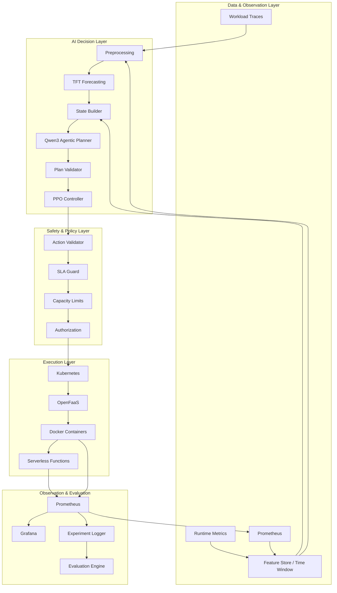
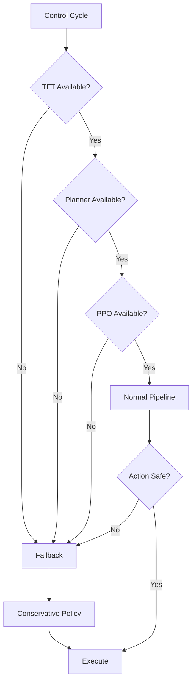
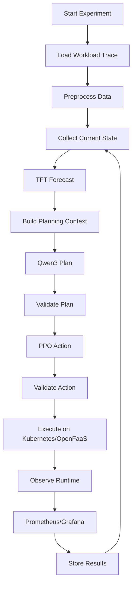

# Project: Predictive Container Management for Energy-Efficient Serverless Computing

> An Agentic AI and Transformer-Based Framework for Intelligent and Energy-Efficient Container Management in Serverless Computing.

## 1. Executive Summary

Serverless computing provisions resources on demand, but two problems dominate:

- **Cold starts** — new containers must initialize before serving requests, spiking latency during demand surges.
- **Idle energy waste** — warm containers kept on standby consume power even with zero invocations.

Traditional reactive autoscaling responds *after* demand changes are observed, so it either scales too late (SLA breaches) or keeps too much capacity warm (energy waste). This project builds a **predictive, autonomous, closed-loop container-management system** that anticipates workload instead of waiting for it:

- **Temporal Fusion Transformer (TFT)** forecasts short-term invocation demand from Azure Functions workload traces.
- **Qwen3 (agentic LLM)** interprets the forecast, system state and SLA status into a high-level management plan.
- **PPO (reinforcement learning)** converts state + plan into fast, bounded, SLA-aware container actions.
- **Kubernetes / OpenFaaS / Docker** execute the actions; **Prometheus / Grafana** measure the outcomes.

The primary optimization objective is:

```
Minimize  E + αL + βCS + γC
subject to  P95 latency ≤ SLA target
```

where `E` = energy, `L` = latency, `CS` = cold starts, `C` = capacity/resource cost, and `α, β, γ` are experimentally tuned weights. SLA protection is the primary constraint and carries the strongest penalty.

---

## 2. Document Purpose

This single document consolidates the project's full specification:

| Document | Covers |
| --- | --- |
| `docs/prd.md` | Product vision, requirements, scope, SLA, reward, risks |
| `docs/architecture.md` | Layered architecture, data flow, failure/deployment design |
| `docs/design.md` | Module structure, schemas, training/design details, implementation order |
| `docs/security.md` | Threat model, trust boundaries, RBAC, allowlist, audit |
| `docs/test_plan.md` | Test strategy, unit/system scenarios, ablations, metrics |

It also incorporates the research survey collected in the repository (see [Research Context](#7-research-context-and-related-work)) and project presentation material.

The project is an **academic/research prototype**. Its purpose is to demonstrate a complete predictive container-management loop rather than claim production-grade cloud infrastructure. Numerical improvements (e.g. energy/cold-start reduction) are **indicative targets**, not guaranteed results.

---

## 3. Project Metadata

| Item | Detail |
| --- | --- |
| Short title | Predictive Container Management for Energy-Efficient Serverless Computing |
| Extended title | An Agentic AI and Transformer-Based Framework for Intelligent and Energy-Efficient Container Management in Serverless Computing |
| Type | Major Project — Phase 1 (academic / research prototype) |
| Institution | Vidyavardhaka College of Engineering, Department of Computer Science and Engineering |
| Guide | Dr. Tej C Hiremath |
| Team | Charan P (4VV23CS042), Darshan S Gowda (4VV23CS052), Gaurav S G (4VV23CS074) |
| Status | Phase 1 — design & documentation complete; implementation pending |

---

## 4. Problem Statement

Serverless workloads are highly variable and burst-prone. The core challenge of serverless container management appears as two opposing failure modes:

### Problem A — Under-provisioning

When demand rises rapidly:

```
Demand ↑
   ↓
Existing capacity becomes insufficient
   ↓
New container/function starts
   ↓
Cold-start delay (runtime initialization)
   ↓
Higher request latency → SLA breaches
```

### Problem B — Over-provisioning

To avoid cold starts, the system may keep many containers active:

```
Large warm pool
   ↓
Low average utilization
   ↓
Unused compute capacity
   ↓
Higher resource / energy consumption
```

Reactive (threshold-based) autoscalers cannot solve this trade-off: they scale after demand changes, so sudden spikes breach the SLA before any action is taken. The project therefore treats container management as a **predictive multi-objective control problem**, formalized as:

```
Minimize  E + αL + βCS + γC
subject to  P95 latency ≤ SLA target
```

---

## 5. Objectives and Indicative Targets

| # | Objective | Description |
| --- | --- | --- |
| 1 | Workload forecasting | TFT predicts short-term invocation demand from multivariate workload and runtime features. |
| 2 | Agentic planning via Qwen3 | High-level reasoning over forecast, system state and SLA to generate orchestration plans. |
| 3 | Proactive scaling | Prewarm or scale containers before demand arrives, eliminating reactive cold-start latency. |
| 4 | SLA protection | Strongly prioritize P95 latency within the SLA target; violations carry the highest penalty. |
| 5 | Energy optimization | Reduce unnecessary active and idle container time to lower overall energy consumption. |
| 6 | Rigorous evaluation | Compare against reactive autoscaling across multiple workload patterns with clear metrics. |

**Indicative targets (not guaranteed results):**

- 15–25% reduction in energy consumption.
- 20–30% reduction in cold-start count.
- P95 latency maintained within the SLA target.
- Improved CPU and memory utilization.
- Reduced over-provisioning.

---

## 6. Proposed Solution

The system anticipates future demand instead of reacting to it. The intended decision chain:

```
Historical workload + runtime metrics
        ↓
Data preprocessing
        ↓
TFT workload forecast
        ↓
Qwen3 planning layer
        ↓
PPO control policy
        ↓
Action validation / SLA guard
        ↓
Kubernetes + OpenFaaS
        ↓
Runtime execution
        ↓
Prometheus metrics
        ↓
Feedback (next control cycle)
```

The key design principle is **separation of responsibilities**:

- **TFT** predicts what may happen next.
- **Qwen3** interprets the predicted situation and forms a high-level management plan.
- **PPO** converts state and plan into a bounded operational action.
- **Kubernetes / OpenFaaS** execute the action.
- **Prometheus / Grafana** measure the result.
- **SLA protection** prevents energy optimization from becoming uncontrolled latency degradation.

Because no single AI component has unrestricted control of infrastructure, the system is deterministic, testable and safe by construction.

---

## 7. Research Context and Related Work

The repository (branch `docs`) contains a curated collection of research papers on serverless autoscaling, cold-start mitigation and energy-aware container management. The following works frame the project:

### 7.1 Closest / directly supporting work

1. **Dynamic Management of Constrained Computing Resources for Serverless Services** (IEEE Transactions on Network and Service Management, 2025; DOI 10.1109/TNSM.2024.3497155)
   Studies container behavior in running/warm/cold states and proposes a multi-queueing algorithm (`AiW`) balancing energy consumption and SLA compliance via container reuse. The `COME` framework achieves 22–64% power reduction. *Closest to this project's energy + SLA + container-state objective.*

2. **Deep Learning and Feedback Control Based Container Auto-Scaling for Cloud Native Micro-Services** (IEEE Transactions on Services Computing, 2025; DOI 10.1109/TSC.2025.3596887)
   Deep-learning prediction combined with feedback control for Kubernetes/container autoscaling with P95 SLA management. *Basis for the project's predictive autoscaling and cloud-native implementation.*

3. **Incendio: Priority-Based Scheduling for Alleviating Cold Start in Serverless Computing** (IEEE Transactions on Computers, 2024; DOI 10.1109/TC.2024.3386063)
   Workload prediction, container pre-warming, container termination and RL-based scheduling. *One of the closest works to this project's predictive cold-start management.*

4. **Tackling Cold Start in Serverless Computing with Multi-Level Container Reuse** (IEEE IPDPS, 2024; DOI 10.1109/IPDPS57955.2024.00017)
   Proposes a DRL-based scheduler for multi-level container reuse, achieving up to 53% reduction in function startup latency using a warm resource pool. *Supports the project's PPO / container-reuse strategy.*

5. **Microservice Autoscaling With Fine-Grained DVFS in Dynamic Multi-Edge Collaboration via Deep Reinforcement Learning** (IEEE Transactions on Network Science and Engineering, 2026; DOI 10.1109/TNSE.2026.3691933)
   DRL-based autoscaling with energy optimization and latency management. *Strengthens the energy-aware reinforcement-learning component.*

6. **FaaShare: Enabling Generic Low-Latency and SLO-Aware GPU Sharing in Serverless Computing** (2026)
   Serverless pre-warming, SLO protection and resource allocation. *Supports the project's SLA/SLO-aware container-management objective.*

### 7.2 Supporting / background literature (in repository)

- **Container-State-Aware Energy Consumption Minimization for Serverless Functions** (IEEE Transactions on Services Computing, 2026) — energy model distinguishing idle/cold-start/running container states; Bayesian-optimization-based energy minimization under cold-start probability constraints.
- **Mitigating Cold Start Problem in Serverless Computing: A Reinforcement Learning Approach** (IEEE IoT Journal, 2023) — two-layer RL + LSTM approach for pre-warming decisions; reduces memory by 12.73%, improves prewarmed invocations by 22.65%.
- **A Deep Recurrent-Reinforcement Learning Method for Intelligent AutoScaling of Serverless Functions** — RRL-based intelligent autoscaling.
- **Deep Reinforcement Learning for Scheduling Applications in Serverless and Serverful Hybrid Computing Environments** — hybrid scheduling via DRL.
- **Cold-Start-Aware Offloading and Resource Allocation by Importance Sampling-Based Double Dueling DQN in Serverless Edge Computing** — cold-start-aware offloading with Double Dueling DQN.
- **Pre-warming: Alleviating Cold Start Occurrences on Cloud-based Serverless Platforms** — pre-warming strategies.
- **Sustainable Serverless Computing With Cold-Start Optimization and Automatic Workflow Resource Scheduling** — sustainability + cold-start + scheduling.
- **Taming Serverless Cold Start of Cloud Model Inference With Edge Computing** — edge-based cold-start mitigation.
- **Serverless Computing: State-of-the-Art, Challenges and Opportunities** — survey framing the field.
- Additional material: BaaSLess (federated serverless workflows), Blending Serverful and Serverless Resources, Deadline-Aware Task Offloading with Concurrency, HealthFaaS, Modeling/PVE of Hybrid Classical-Quantum Serverless, Toward Latency-Sensitive Generative AI Provision, MSARS (meta-learning + RL for SLO allocation/adaptive scaling).

### 7.3 Gaps addressed by this project

Most prior work targets **one** dimension (either pure pre-warming, pure DRL autoscaling, or pure energy modeling). This project is distinguished by a **closed-loop, three-stage control stack** — TFT forecasting → Qwen3 agentic planning → PPO control — with a deterministic safety/validation layer and end-to-end comparison against a reactive baseline.

---

## 8. Scope

### 8.1 In scope

**Data**
- Historical workload traces (Azure Functions traces).
- Runtime metrics (CPU, memory, active/warm containers, latency, cold starts, power/energy).
- Time-series preprocessing and feature engineering.

**AI**
- TFT forecasting (30-interval history → 5–15 minute horizon).
- Qwen3 agentic planning.
- PPO policy/control with SLA-aware reward.

**Infrastructure**
- Docker (containers), Kubernetes (orchestration), OpenFaaS (serverless runtime), Prometheus (metrics), Grafana (dashboards).

**Evaluation**
- Reactive baseline; component ablation; forecast accuracy; latency / P95 latency; SLA compliance; cold starts; resource utilization; energy measurement or estimation.

### 8.2 Out of scope

- Full commercial production deployment.
- Multi-cloud orchestration.
- Automatic retraining from uncontrolled production data.
- Autonomous arbitrary shell execution by an LLM.
- Guaranteed numerical energy reduction before experiments.
- Handling confidential customer data.

---

## 9. Architecture

The architecture intentionally connects predictive AI, agentic planning, reinforcement learning and cloud-native execution into one closed loop, layered so that **no single AI component has unrestricted control of infrastructure**.

### 9.1 Complete architecture



### 9.2 Layer overview

| Layer | Component | Responsibility |
| --- | --- | --- |
| 1 | Data & Observation | Workload traces, runtime metrics, Prometheus, time-window aggregation (e.g. 30 fixed intervals → TFT input). |
| 2 | Preprocessing | Validation, missing-value handling, resampling, feature engineering, normalization. **No future leakage.** |
| 3 | TFT Forecasting | `X(t-k…t) → ŷ(t+1…t+h)`; predicted invocation rate, trend, optional prediction intervals. |
| 4 | State Builder | Merges forecast + current observations into one decision state (JSON). |
| 5 | Qwen3 Agentic Planner | High-level strategy produced from forecast + state + SLA. Never executes infrastructure commands directly. |
| 6 | Plan Validator | Schema, approved-strategy and capacity-bounds checks before PPO. |
| 7 | PPO Controller | Selects `NoOp / PreWarm / ScaleOut / Reuse / ScaleIn / Terminate`. |
| 8 | SLA Guard | Deterministic, model-independent guard (e.g. block aggressive scale-in when P95 is near the threshold). |
| 9 | Action Validator | Schema → min/max capacity → rate limit → SLA guard → authorization → executor. |
| 10 | Kubernetes / OpenFaaS | Executor translates abstract actions into permitted platform operations. |

### 9.3 Closed-loop control

```
OBSERVE → FORECAST → PLAN → CONTROL → VALIDATE → EXECUTE → MEASURE → FEEDBACK (loop)
```

### 9.4 Deployment architecture

```
                 Kubernetes Cluster
┌──────────────────────────────────────────────────┐
│                                                  │
│  ┌───────────────┐     ┌─────────────────────┐  │
│  │ OpenFaaS      │     │ AI Services         │  │
│  │ Functions     │     │ TFT                 │  │
│  │ Containers    │     │ Qwen3               │  │
│  └───────────────┘     │ PPO                 │  │
│                        │ Orchestrator        │  │
│                        └─────────────────────┘  │
│                                                  │
│  ┌────────────────────────────────────────────┐  │
│  │ Monitoring                                 │  │
│  │ Prometheus + Grafana                       │  │
│  └────────────────────────────────────────────┘  │
└──────────────────────────────────────────────────┘
```

### 9.5 Failure architecture

Any AI/service failure (TFT, Qwen3, PPO, Kubernetes API, Prometheus) falls back to a **conservative, bounded reactive policy** — the system fails closed, never open:



---

## 10. System Design

### 10.1 Module structure (recommended layout)

```text
project/
│
├── data/
│   ├── raw/
│   ├── processed/
│   ├── ingestion.py
│   ├── preprocessing.py
│   └── feature_engineering.py
│
├── forecasting/
│   ├── tft_model.py
│   ├── train.py
│   ├── evaluate.py
│   └── inference.py
│
├── agent/
│   ├── planner.py
│   ├── prompts/
│   ├── schemas.py
│   └── validator.py
│
├── rl/
│   ├── environment.py
│   ├── reward.py
│   ├── train_ppo.py
│   ├── evaluate_ppo.py
│   └── policy.py
│
├── orchestrator/
│   ├── decision_loop.py
│   ├── state_builder.py
│   ├── action_validator.py
│   ├── sla_guard.py
│   └── executor.py
│
├── infrastructure/
│   ├── kubernetes/
│   ├── openfaas/
│   └── docker/
│
├── monitoring/
│   ├── prometheus/
│   └── grafana/
│
├── experiments/
│   ├── baseline/
│   ├── scenarios/
│   ├── ablation/
│   └── evaluation/
│
└── configs/
    └── project.yaml
```

### 10.2 Data schema (conceptual observation record)

```json
{
  "timestamp": "2026-01-01T10:00:00",
  "function_id": "function_a",
  "invocation_rate": 620,
  "execution_duration_ms": 45,
  "cpu_utilization": 0.72,
  "memory_utilization": 0.68,
  "active_containers": 8,
  "warm_containers": 7,
  "cold_starts": 2,
  "latency_ms": 170,
  "p95_latency_ms": 210,
  "power_w": 120
}
```

### 10.3 Feature engineering

- **Lag features:** `workload(t-1), workload(t-2), workload(t-3), …`
- **Rolling features:** moving average, moving max/min, rolling standard deviation.
- **Temporal features:** hour, day-of-week, weekend, peak-period.
- **System features:** CPU, memory, active containers, latency, cold starts.

### 10.4 Dataset splitting

Chronological split only — never random shuffle for time series:

```text
|------ Train ------|-- Validation --|-- Test --|
       (earlier)                    (later)
```

### 10.5 TFT training

Training loop: processed time series → window generator → train TFT → validation → (tune / accept) → save checkpoint. Record: history window, forecast horizon, feature list, epochs, learning rate, batch size, seed, checkpoint path.

### 10.6 Forecast output

```json
{
  "forecast_horizon": 5,
  "predicted_workload": [710, 760, 820, 900, 960],
  "trend": "increasing"
}
```

### 10.7 Qwen3 planner

Prompt defines role, input schema, allowed strategies, constraints, output schema, and an explicit prohibition on infrastructure commands:

```text
ROLE:
You are a serverless resource-management planner.

INPUT:
Forecast + current system state + constraints.

ALLOWED STRATEGIES:
NoOp, PreWarm, ScaleOut, Reuse, ScaleIn, Terminate.

RULE:
Return structured planning information only.
Do not return shell commands.
Do not return Kubernetes YAML.
Do not bypass SLA constraints.
```

Planner output schema:

```json
{
  "strategy": "prewarm",
  "desired_capacity_change": 3,
  "priority": "sla",
  "urgency": "high",
  "reason": "forecasted demand increase",
  "constraints_respected": true
}
```

### 10.8 PPO environment

- **Observation space:** `[predicted_workload, current_workload, cpu, memory, latency, p95_latency, active_containers, cold_starts, energy, sla_margin]`.
- **Action space:** `0=NoOp, 1=PreWarm, 2=ScaleOut, 3=Reuse, 4=ScaleIn, 5=Terminate`. Capacity change may be a bounded discrete action.
- **SLA margin** derived feature: `SLA threshold − current P95 latency` (positive = headroom, zero = at threshold, negative = violation).

### 10.9 Reward design

```text
R_t = -(w_e·E_t + w_l·L_t + w_c·CS_t + w_r·RC_t + w_u·U_t) − w_s·V_t
```

- `E_t` normalized energy/resource consumption
- `L_t` latency cost
- `CS_t` cold-start cost
- `RC_t` resource/capacity cost
- `U_t` underutilization cost
- `V_t` SLA violation indicator/penalty
- `w_*` experimentally selected weights

Components are normalized so one metric does not dominate purely by scale. The SLA penalty must be strong enough that aggressively reducing containers is never an attractive reward strategy.

### 10.10 Action validator

Checks: (1) action known? (2) capacity change within bounds? (3) target function valid? (4) action allowed in current state? (5) any safety condition violated? (6) executor authorized?

### 10.11 SLA guard (deterministic, independent)

```python
if requested_scale_in and p95_latency >= sla_threshold:
    reject_or_delay_scale_in()
```

### 10.12 Executor

Translates **approved abstract actions** into platform-specific operations (Kubernetes/OpenFaaS API). Never accepts raw arbitrary commands from Qwen3.

### 10.13 Control-cycle timing (example)

```text
T0   collect metrics → T0+1 preprocess → T0+2 forecast → T0+3 plan
T0+4 PPO decision → T0+5 validation → T0+6 execution → T0+7 observe → T0+8 evaluate
```

### 10.14 State persistence

Store each transition (for debugging and PPO training/evaluation):

```json
{
  "state_before": {},
  "forecast": {},
  "plan": {},
  "action": "prewarm",
  "execution_result": "success",
  "state_after": {},
  "reward": -0.23
}
```

### 10.15 Experiment configuration (example — not established optimal values)

```yaml
project:
  name: predictive-container-management

sla:
  p95_latency_ms: 250
  safety_margin_ms: 20

containers:
  min: 2
  max: 30
  max_change_per_cycle: 5

forecast:
  history_window: 30
  horizon: 5

control:
  interval_seconds: 60

evaluation:
  repetitions: 5
```

---

## 11. Functional Requirements

| ID | Requirement |
| --- | --- |
| FR-01 | **Workload Ingestion** — accept time-series workload data: timestamp, function/application id, invocation count/rate, execution duration. |
| FR-02 | **Runtime Metric Collection** — collect/derive CPU, memory, active containers, warm containers, latency, P95 latency, cold starts, power/energy where available. |
| FR-03 | **Preprocessing** — sort chronologically, handle missing values, resample to control interval, generate lag + time/context features, normalize. |
| FR-04 | **Forecasting** — TFT produces a configurable-horizon forecast (e.g. 30-step window → next 5 steps). |
| FR-05 | **Agentic Planning** — Qwen3 receives structured forecast + state and returns a structured strategy (`NoOp, PreWarm, ScaleOut, Reuse, ScaleIn, Terminate`); must not execute infrastructure commands. |
| FR-06 | **PPO Control** — use state + approved plan to select an operational action. |
| FR-07 | **SLA Protection** — monitor an explicit SLA target (P95 latency); violations carry a strong negative penalty. |
| FR-08 | **Action Validation** — every action passes schema → capacity → SLA safety → authorization → execution. |
| FR-09 | **Monitoring** — Prometheus collects metrics, Grafana displays them. |
| FR-10 | **Experiment Logging** — per cycle store what was predicted, planned, selected, executed, and what happened afterward. |

---

## 12. Non-Functional Requirements

| ID | Requirement |
| --- | --- |
| NFR-01 | **Performance** — the decision pipeline must fit within the selected control interval. |
| NFR-02 | **Reliability** — model/service failure must not produce unrestricted infrastructure actions. |
| NFR-03 | **Reproducibility** — record dataset/trace, config, model versions, seeds, environment, timestamps. |
| NFR-04 | **Maintainability** — each major component independently replaceable. |
| NFR-05 | **Security** — least privilege and closed action spaces. |
| NFR-06 | **Observability** — major decisions visible through logs and metrics. |

---

## 13. Security Design

> Primary principle: **No AI component should have unrestricted authority over infrastructure.**

### 13.1 Security architecture

```
External/Workload Data → Input Validation → TFT → Qwen3
  → Output Schema Validation → Policy Validation → PPO
  → Action Validation → SLA Guard → RBAC/Authorization
  → Restricted Executor → Kubernetes/OpenFaaS → Monitoring/Audit
```

### 13.2 Threat model

| ID | Threat | Protection |
| --- | --- | --- |
| T01 | Prompt injection via workload metadata | Treat metadata as untrusted; structured fields; no untrusted text in system instructions; restricted output schema; independent validation. |
| T02 | Unsafe/malformed LLM output | Schema validation → policy validation → reject if invalid → fallback. |
| T03 | Runaway scaling (repeated ScaleOut) | min/max capacity, max change/cycle, cooldown, rate limiting, emergency stop. |
| T04 | Unauthorized Kubernetes access | Dedicated service account, RBAC, restricted namespace, no cluster-admin, action-specific executor. |

### 13.3 Trust boundaries

1. **Data → AI:** all external data is untrusted.
2. **Qwen3 → Control:** LLM output is untrusted.
3. **PPO → Executor:** learned actions are untrusted until policy validation.
4. **Executor → Kubernetes:** authorization required.

### 13.4 Least privilege & RBAC

```
Qwen3 → Planner service → PPO service → Safety controller → Restricted executor → Kubernetes/OpenFaaS
```

Qwen3 must **not** receive a Kubernetes token. Use `ServiceAccount → Role → RoleBinding` with the minimal permissions; never `cluster-admin` for the autonomous controller.

### 13.5 Action allowlist & parameter bounds

Only `NoOp / PreWarm / ScaleOut / Reuse / ScaleIn / Terminate` are executable; no arbitrary shell code. Example checks: `requested_capacity = 50 > max = 30 → reject`; `requested_capacity = 0 < min = 2 → reject`.

### 13.6 Additional controls

- **Secrets:** never in source, prompts, logs, model input, or Git; use secret management.
- **Container security:** non-root, minimal images, scanning, pinned versions, no privileged, dropped capabilities, resource limits, read-only FS where practical.
- **Network security:** TLS, auth, network policies, restricted ingress/egress, private K8s API.
- **Monitoring security:** protect Prometheus/Grafana/K8s AI endpoints.
- **Audit logging:** one record per action (timestamp, experiment id, forecast, strategy, ppo action, requested change, validated/executed flags, SLA status); never store secrets.
- **Model security:** version + checksum controlled TFT checkpoint, PPO policy, config, prompts, action schema.
- **Data privacy:** only data necessary for control; never send personal/payload/auth data to the planning model; prefer synthetic/anonymized traces.

### 13.7 Security test cases

| ID | Attack / Failure | Expected |
| --- | --- | --- |
| SEC01 | Invalid Qwen3 strategy | Reject |
| SEC02 | Arbitrary shell command | Reject |
| SEC03 | Capacity > max | Reject |
| SEC04 | Capacity < min | Reject |
| SEC05 | Prompt injection | No privilege escalation |
| SEC06 | Missing credential | Controlled failure |
| SEC07 | Unauthorized Kubernetes API | Denied |
| SEC08 | Runaway scaling | Rate/bounds stop it |
| SEC09 | Secret in logs | Must not appear |
| SEC10 | Compromised container | Restricted permissions |
| SEC11 | AI service failure | Safe fallback |
| SEC12 | Monitoring exposure | Access controlled |

### 13.8 Security acceptance criteria

Qwen3 cannot directly execute arbitrary Kubernetes commands; PPO cannot bypass action validation; capacity is bounded; the SLA guard is independent of the learned policy; K8s access follows least privilege; secrets are not hard-coded; invalid model output is rejected; all infrastructure actions are auditable; AI/service failure has a safe fallback; container privileges are minimized.

---

## 14. Testing and Validation

### 14.1 Test levels

```
Unit → Component → Integration → System → Performance → Reliability → Security → Experimental evaluation
```

Do not move to final comparison until the control pipeline produces valid and bounded actions.

### 14.2 Unit test matrix

| ID | Module | Test | Expected |
| --- | --- | --- | --- |
| U01 | Data | Valid trace | Loads successfully |
| U02 | Data | Missing value | Controlled handling |
| U03 | Data | Wrong timestamp | Rejected/handled |
| U04 | TFT | Correct input shape | Accepted |
| U05 | TFT | Forecast output | Correct horizon |
| U06 | TFT | Invalid input | Controlled error |
| U07 | Planner | Valid JSON | Accepted |
| U08 | Planner | Invalid strategy | Rejected |
| U09 | PPO | Valid state | Valid action |
| U10 | PPO | Invalid state | Rejected |
| U11 | Validator | Capacity overflow | Rejected |
| U12 | SLA guard | Unsafe scale-in | Blocked/deferred |

### 14.3 Component tests

- **Data (D01–D04):** chronological ordering, duplicate records, missing metrics, outliers (negative rates/latency, CPU > 100%, memory < 0). Outliers must not silently enter training data.
- **TFT (T01–T04):** input window length, horizon length, no leakage (`train time < val time < test time`), accuracy via `MAE / RMSE / MAPE` (MAPE interpreted carefully when workload → 0).
- **Qwen3 (Q01–Q06):** valid context, high-demand, low-demand, SLA-risk, prompt injection, invalid output → schema validator → reject → fallback.
- **PPO (R01–R04):** action set membership, capacity bounds (`min ≤ capacity ≤ max`), SLA penalty decreases reward under simulated violation, energy trade-off reflected in reward.

### 14.4 Integration tests

```
I01  Metrics → preprocessing → TFT
I02  TFT → state builder → Qwen3
I03  Qwen3 → validator → PPO
I04  PPO → safety guard → executor
I05  Executor → runtime → Prometheus
I06  Prometheus → next control cycle
```

### 14.5 System test scenarios

| ID | Scenario | Goals / measures |
| --- | --- | --- |
| S01 | Low workload | Idle resource reduction; containers, CPU, energy, latency, SLA. |
| S02 | Stable workload | No unnecessary oscillation; scaling events, utilization, energy, SLA. |
| S03 | Sudden spike (low→medium→very high) | Forecast lead time, cold starts, P95, SLA violations, prewarm timing. |
| S04 | Workload drop | Scale-in response, idle capacity, post-scale-in latency. |
| S05 | Periodic workload (morning↑/afternoon↓/evening↑) | Predictive behavior. |
| S06 | Highly irregular workload | Robustness when historical patterns are weak. |

### 14.6 Reliability tests

- **F01 TFT failure** → bounded fallback.
- **F02 Qwen3 failure** → no arbitrary action; fallback.
- **F03 PPO failure** → safe policy.
- **F04 Kubernetes API failure** → controlled error, retry/fallback.
- **F05 Prometheus failure** → detect stale/missing metrics.
- **F06 Model output corruption** → validator blocks execution.

### 14.7 Stress tests

Increase request rate, number of functions, number of containers, control frequency. Measure decision latency, executor latency, monitoring overhead, CPU/memory overhead, stability.

### 14.8 Baseline and ablation evaluation

**Baseline:** run Experiment A (reactive baseline) and Experiment B (TFT + Qwen3 + PPO) with all non-policy variables equal — same workload, cluster, resource limits, monitoring, duration, metrics.

**Ablation:**

| Experiment | TFT | Qwen3 | PPO | SLA Guard |
| --- | --- | --- | --- | --- |
| Baseline | No | No | No | Baseline |
| A1 | Yes | No | No | Yes |
| A2 | Yes | Yes | No | Yes |
| A3 | No | Yes | Yes | Yes |
| A4 | Yes | Yes | Yes | No |
| Full | Yes | Yes | Yes | Yes |

Purpose is **attribution** of each component, not just a single overall result.

### 14.9 Acceptance criteria

- All critical unit tests pass; forecast pipeline, validated planner, bounded PPO actions, working SLA guard, working infrastructure execution, working monitoring, working failure fallback.
- Baseline and proposed experiments repeatable.
- Results generated from raw recorded measurements.

---

## 15. Evaluation Metrics

| Category | Metric | Formula / definition |
| --- | --- | --- |
| Forecast | MAE | `(1/n) Σ |y_i − ŷ_i|` |
| Forecast | RMSE | `sqrt((1/n) Σ (y_i − ŷ_i)²)` |
| Forecast | MAPE | `(100/n) Σ |y_i − ŷ_i| / y_i` (careful near zero) |
| Latency | Mean / P95 | measured |
| SLA | Compliance | `(requests satisfying SLA / total evaluated requests) × 100` |
| Cold start | Rate | `cold-start requests / total requests` |
| Utilization | Average | `used capacity / available capacity` |
| Energy | Total | `∫ Power(t) dt` (sampled: `Σ P_i × Δt`) |
| Energy | per request | `total measured energy / total completed requests` |
| Relative change | vs baseline | `((Baseline − Proposed) / Baseline) × 100` (only where lower is better) |

**Energy measurement policy:** if direct measurement is unavailable, clearly label values as estimates from a documented power model. Never present estimated energy as directly measured energy.

**Statistical repetition:** multiple trials per scenario, consistent environment, seeds recorded where applicable, identical traces across baseline/proposed runs, report mean + variation, preserve raw result files.

---

## 16. Monitoring Dashboard (Grafana)

- **Workload:** actual invocation rate, predicted invocation rate.
- **Infrastructure:** active containers, CPU, memory.
- **Performance:** mean latency, P95 latency, SLA threshold.
- **Efficiency:** power/energy, energy/request, resource utilization.
- **AI control:** planner strategy, PPO action, action frequency, reward.

**Logging — minimum fields per cycle:** timestamp, experiment id, trace id, forecast, forecast error, current workload, CPU, memory, active containers, P95, cold starts, Qwen3 plan, PPO action, validation result, execution result, energy, reward, SLA status.

---

## 17. Technology Stack

| Category | Tool / Library | Role |
| --- | --- | --- |
| Programming | Python | Orchestration, ML/RL pipelines |
| Data processing | Pandas, NumPy | Cleaning, resampling, feature engineering |
| Deep learning | PyTorch | Model implementation |
| Prediction | Temporal Fusion Transformer (TFT) | Workload forecasting |
| Agentic AI | Qwen3 | High-level planning & reasoning |
| Reinforcement learning | PPO (e.g. Stable-Baselines3/RLlib) | Fast SLA-aware control |
| Serverless | OpenFaaS | Function execution runtime |
| Containerization | Docker | Application containers |
| Orchestration | Kubernetes | Container lifecycle & scaling |
| Monitoring | Prometheus + Grafana | Metrics collection & dashboards |
| Dataset | Azure Functions traces | Historical workload patterns |
| Development | Jupyter Notebook / VS Code | Experimentation & implementation |

**Layer summary:** ML/AI layer (PyTorch · TFT · Qwen3 · PPO) → Infrastructure layer (Kubernetes · OpenFaaS · Docker) → Observability layer (Prometheus · Grafana).

---

## 18. Implementation Plan

Recommended development sequence (from `docs/design.md`):

1. Build the data pipeline (ingestion, preprocessing, feature engineering).
2. Implement the reactive baseline.
3. Implement monitoring (Prometheus/Grafana).
4. Train and evaluate the TFT forecast model.
5. Implement the PPO environment and reward.
6. Add the SLA-aware reward and penalty.
7. Add the Qwen3 agentic planner (prompts, schemas, validation).
8. Add action/safety validators (incl. SLA guard).
9. Integrate Kubernetes/OpenFaaS execution.
10. Run controlled baseline vs proposed experiments.
11. Build dashboards and result reporting.
12. Perform ablation and final evaluation (reliability, stress, statistics).

Reference configuration to start with: SLA `p95_latency_ms: 250`, `containers.min: 2`, `containers.max: 30`, `max_change_per_cycle: 5`, forecast `history_window: 30`, `horizon: 5`, control `interval_seconds: 60`, evaluation `repetitions: 5`.

---

## 19. Risks and Mitigations

| Risk | Mitigation |
| --- | --- |
| Forecast is inaccurate | Evaluate multiple workload patterns; report MAE/RMSE/MAPE. |
| LLM output is inconsistent | Structured schema + validator + fallback. |
| PPO behaves unexpectedly | Bounded actions + offline/testing stage. |
| Energy measurement unavailable | Use clearly documented estimation models. |
| Kubernetes instability | Controlled local cluster/test environment. |
| SLA violations | Strong SLA penalty + deterministic safety guard. |
| Excessive scaling | Min/max limits, max change/cycle, cooldown, rate limiting. |
| Model service unavailable | Conservative reactive fallback. |

---

## 20. Deliverables

1. Dataset preprocessing pipeline.
2. TFT model / training pipeline.
3. Qwen3 planner.
4. PPO environment and policy.
5. SLA reward mechanism.
6. Action validator + SLA guard.
7. Kubernetes/OpenFaaS deployment.
8. Monitoring dashboard (Prometheus/Grafana).
9. Reactive baseline implementation.
10. Experiment scripts (baseline, scenarios, ablation).
11. Results (raw data, plots, tables).
12. Project report.
13. Presentation.
14. Architecture / design / test / security documents (see `docs/`).

---

## 21. User/Operator Workflow



---

## 22. Success Criteria

The project is considered technically complete when:

- The end-to-end control loop works.
- The forecasting model produces valid forecasts.
- Qwen3 produces schema-valid plans.
- PPO selects valid, bounded actions.
- The action validator rejects invalid operations.
- Kubernetes/OpenFaaS execution works.
- Monitoring captures outcomes.
- Baseline comparison is reproducible.
- Results contain **measured** rather than assumed improvements.

Numerical targets (e.g. 15–25% energy reduction, 20–30% cold-start reduction) are **targets**, not pre-existing results.

---

## 23. References

### Selected primary references (see section 7)

1. Adeppady, M., Conte, A., Giaccone, P., Karl, H., & Chiasserini, C. F. (2025). *Dynamic Management of Constrained Computing Resources for Serverless Services.* IEEE TNSM. DOI 10.1109/TNSM.2024.3497155.
2. *Deep Learning and Feedback Control Based Container Auto-Scaling for Cloud Native Micro-Services.* (2025). IEEE TSC. DOI 10.1109/TSC.2025.3596887.
3. *Incendio: Priority-Based Scheduling for Alleviating Cold Start in Serverless Computing.* (2024). IEEE TC. DOI 10.1109/TC.2024.3386063.
4. Zhou, A. C., et al. (2024). *Tackling Cold Start in Serverless Computing with Multi-Level Container Reuse.* IEEE IPDPS. DOI 10.1109/IPDPS57955.2024.00017.
5. *Microservice Autoscaling With Fine-Grained DVFS in Dynamic Multi-Edge Collaboration via Deep Reinforcement Learning.* (2026). IEEE TNSE. DOI 10.1109/TNSE.2026.3691933.
6. *FaaShare: Enabling Generic Low-Latency and SLO-Aware GPU Sharing in Serverless Computing.* (2026).

### Supporting literature

- Zhang, J., et al. (2026). *Container-State-Aware Energy Consumption Minimization for Serverless Functions.* IEEE TSC.
- Vahidinia, P., Farahani, B., & Shams Aliee, F. (2023). *Mitigating Cold Start Problem in Serverless Computing: A Reinforcement Learning Approach.* IEEE IoT Journal.
- *Serverless Computing: State-of-the-Art, Challenges and Opportunities.*
- Full research collection available on the `docs` branch of this repository (see section 7.2).

---

## 24. Repository Map

```text
├── README.md          ← project landing page (this project's front door)
├── project.md         ← complete project specification (this document)
├── docs/              ← expanded detail: prd, architecture, design, security, test_plan
└── docs-simpler/      ← compact versions of the same documents
```

> Note: the `docs` git branch additionally stores the research survey (PDFs) and Phase-1 presentation material (PPTX).