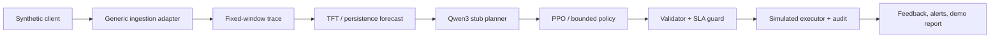

# M9 Deferred Demonstration Integration

- Generated at: `2026-11-20T09:15:50.595740+00:00`
- Evidence tier: **simulation_synthetic_client_no_live_execution**
- Scenario: `mixed` with seed `42`
- Synthetic requests: `2100` across `['fn_checkout', 'fn_search', 'fn_recommend']`
- Ingestion auth: `disabled`; no tokens are persisted
- Sample services are scaffolding only; live deployment was deferred

## Flow

## Simulated control summary

| Metric | Value |
|---|---:|
| Mean reward | -0.2711 |
| Reward std | 0.0000 |
| SLA violation rate | 0.0000 |
| Mean energy (W) | 35.0000 |
| Mean capacity | 2.0000 |
| Shield intervention rate | 0.0000 |

## Service routing (simulated counts)

| Service | Payload class | Requests | Errors |
|---|---|---:|---:|
| fn_checkout | large | 40 | 0 |
| fn_checkout | medium | 168 | 2 |
| fn_checkout | small | 468 | 3 |
| fn_recommend | large | 52 | 1 |
| fn_recommend | medium | 212 | 1 |
| fn_recommend | small | 443 | 2 |
| fn_search | large | 60 | 0 |
| fn_search | medium | 208 | 2 |
| fn_search | small | 449 | 5 |

## Presentation storyboard

1. Problem: serverless capacity and energy trade-off under a P95 SLA.
2. Architecture: forecast -> planner -> PPO -> validators -> execution -> observation.
3. Data: Azure invocation trace plus explicitly simulated resource proxies.
4. Demo: synthetic requests arrive for checkout/search/recommend services.
5. Control loop: one decision cycle with forecast, plan, action, guard, and audit.
6. Evidence: M8 consolidated simulation tables and ablations; no live cluster claims.
7. Limitations: live Kubernetes/OpenFaaS/Docker and Grafana validation deferred.
8. Closing: reproducible artifacts and safety boundaries, with measured values only from simulation.

The final PPTX and image assets remain archive material on the `files` branch and were not edited.
