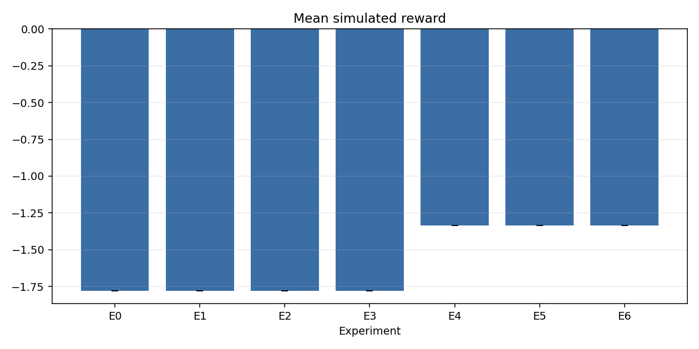
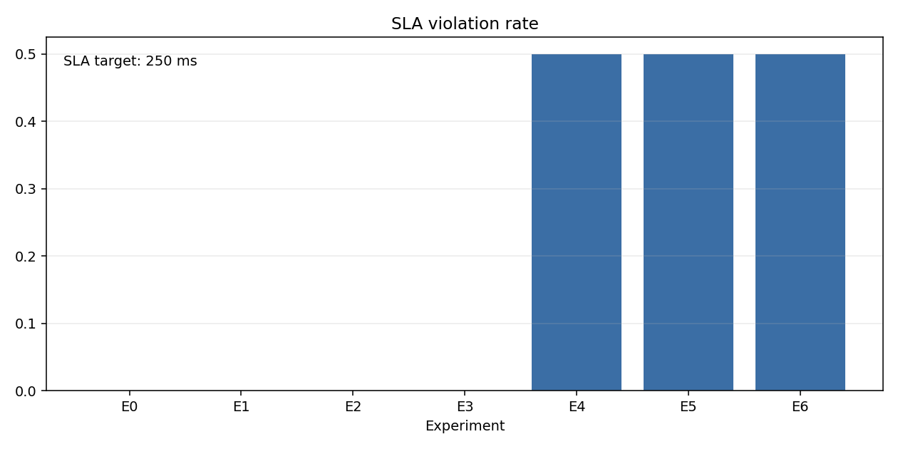
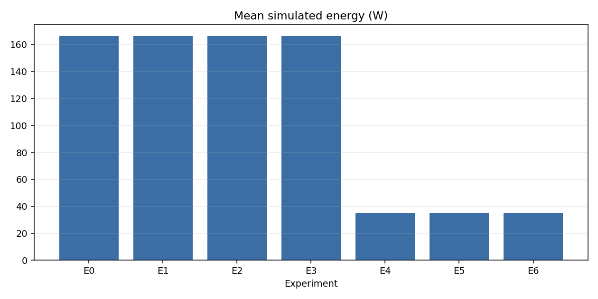
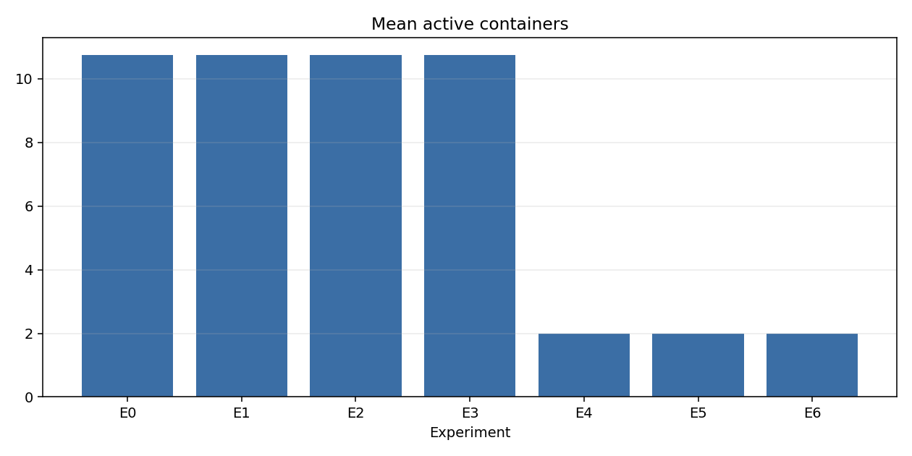

# M8 — Consolidated Evaluation Report

**Evidence tier:** simulated closed-loop replay; dry-run execution only. No live cluster, live energy, live latency or Grafana measurement is claimed.

## 1. Dataset and licensing

Azure Functions 2019 invocation traces are a historical workload data source only (CC-BY-4.0). Synthetic scenarios are deterministic and generated locally. See the manifest for trace hashes, schema and coverage.

## 2. Trace schema, units and time coverage

- `timestamp`, `invocation_count`, `cpu_utilization`, `memory_utilization`, derived time/cyclic features.
- Invocation count is scaled to the configured container capacity envelope; CPU/memory proxies are simulated when absent.
- Coverage and per-workload SHA-256 are recorded in `run_manifest.json` and `workloads.json`.

## 3. Data preparation and split

Chronological 70/15/15 split is used by the forecast track; control-loop workloads use the predeclared held-out segment/short scenario window. No random shuffle is used.

## 4. Model configurations and seeds

- Config SHA-256: `8351693e068085e8d09c47afefb18ce16063229c4948ca38f0b7a575722adf51`
- Commit: `db8d8a6`
- Seeds: `[42]`
- Steps per run: `4`
- TFT checkpoint available: `False`
- PPO checkpoint available: `True`
- Qwen3 runtime: unavailable/stub proxy in this environment; no real Qwen3 result is reported.

## 5. Forecast results

See `results/forecast/azure2019_total/metrics.json` for the separate TFT/baseline evaluation. This runner records whether TFT was actually used per run; fallback runs are marked `degraded_tft_fallback`.

## 6. PPO training/evaluation results

See `results/ppo/m5/` for the multi-seed PPO training/evaluation artifacts. This runner loads the policy checkpoint and compares it against rule/reactive baselines on identical workload frames.

## 7. Agentic planner evaluation

See `results/planner/` for planner validation/latency artifacts. `qwen3_stub` rows are offline stubs, not Qwen3 measurements.

## 8. End-to-end comparison and ablations

E0-E6 form a predeclared ablation ladder. E7 is deferred until a live cluster and deployed metrics stack are available.

| experiment_id | forecast | planner | controller | executor | runs | degraded_runs | mean_reward | reward_std | reward_ci95 | sla_violation_rate | mean_energy_w | mean_capacity | mean_cold_starts | shield_intervention_rate | status |
| --- | --- | --- | --- | --- | --- | --- | --- | --- | --- | --- | --- | --- | --- | --- | --- |
| E0 | none | rules | rules | simulator | 1 | 0 | -1.7786 | 0.0000 | 0.0000 | 0.0000 | 166.2500 | 10.7500 | 2.5000 | 0.0000 | ok |
| E1 | persistence | rules | rules | simulator | 1 | 0 | -1.7786 | 0.0000 | 0.0000 | 0.0000 | 166.2500 | 10.7500 | 2.5000 | 0.0000 | ok |
| E2 | tft | rules | rules | simulator | 1 | 1 | -1.7786 | 0.0000 | 0.0000 | 0.0000 | 166.2500 | 10.7500 | 2.5000 | 0.0000 | degraded_tft_fallback |
| E3 | tft | qwen3_stub | rules | simulator | 1 | 1 | -1.7786 | 0.0000 | 0.0000 | 0.0000 | 166.2500 | 10.7500 | 2.5000 | 0.0000 | degraded_tft_fallback,stub_proxy |
| E4 | persistence | rules | ppo | simulator | 1 | 0 | -1.3351 | 0.0000 | 0.0000 | 0.5000 | 35.0000 | 2.0000 | 0.0000 | 0.0000 | ok |
| E5 | tft | rules | ppo | simulator | 1 | 1 | -1.3351 | 0.0000 | 0.0000 | 0.5000 | 35.0000 | 2.0000 | 0.0000 | 0.0000 | degraded_tft_fallback |
| E6 | tft | qwen3_stub | ppo | simulator | 1 | 1 | -1.3351 | 0.0000 | 0.0000 | 0.5000 | 35.0000 | 2.0000 | 0.0000 | 0.0000 | degraded_tft_fallback,stub_proxy |
| E7 | selected | selected | selected | live_deferred | 0 | 0 |  |  |  |  |  |  |  |  | not_run_requires_live_cluster |

## 9. SLA protection

The SLA target is 250 ms P95. SLA violations are reported from the simulated environment; the safety shield remains the final authority in every arm.

## 10. Energy measurement caveat

Energy values are `power_per_container_w * active_containers + idle_power_w` from the simulator, not metered wall-plug or cloud billing data.

## 11. Limitations

- Live execution, live Prometheus/Grafana values and real Qwen3 are not validated here.
- Confidence intervals are normal approximations over matched-run means, not independently sampled physical trials.
- Azure CPU/memory/energy/latency/cold-start values are simulated proxies; the trace supplies invocations only.

## 12. Reproducibility

```powershell
py -m experiments.evaluate_m8 --config configs/project.yaml --out-dir results\evaluation\m8 --seeds 42 --steps 4 --scenarios mixed --trace-csv data/processed/azure_features.csv --include-trace
```

Artifacts: `run_manifest.json`, `runs.csv`, `aggregates.csv`, `workloads.json`, `figures/`, `runs/`.

## 13. Implemented architecture

```mermaid
flowchart LR
  A[Workload registry] --> B[TFT or persistence forecast]
  B --> C[Stub planner / Qwen3 stub proxy]
  C --> D[Rules or PPO controller]
  D --> E[Safety shield and validators]
  E --> F[Bounded executor; dry-run in research runs]
  F --> G[Simulated environment outcome]
  G --> H[Feedback, alerts, decision/audit logs]
  H --> I[M8 aggregate report and figures]
```



## 14. Figures








